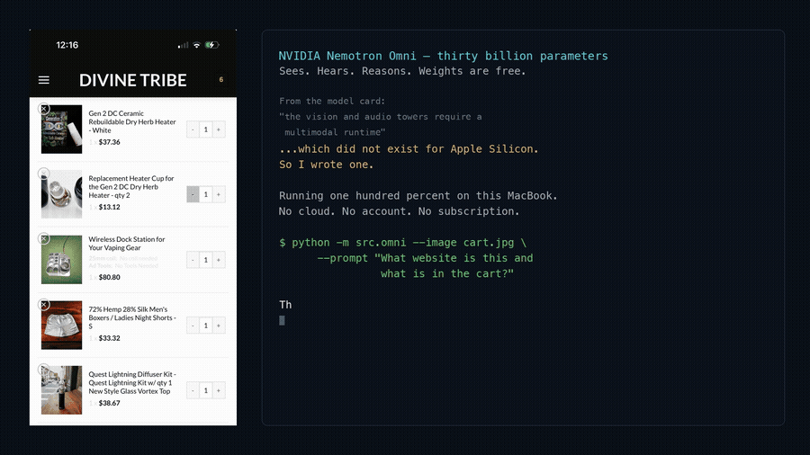

# nemotron-omni-mlx

Run NVIDIA's Nemotron-3-Nano-Omni-30B-A3B on an Apple Silicon Mac with all three inputs working:
text, images (and video), and audio. You give it a prompt plus an image, a video or an audio clip,
and it answers in text. Nothing is sent to the cloud.

<video controls preload="none" poster="demo-poster.jpg" width="100%">
  <source src="nemotron-omni-mlx-demo.mp4" type="video/mp4">
</video>

The clip above is the 35 second demo from the repo: a screenshot of a real store cart, read by the
model on a laptop. A narrated version and a write-up are on
[nicedreamzwholesale.com](https://nicedreamzwholesale.com/2026/07/16/nvidia-nemotron-omni-mlx-apple-silicon-vision-audio-runtime/).

## The gap it fills

NVIDIA released [Nemotron-3-Nano-Omni-30B-A3B](https://huggingface.co/nvidia/Nemotron-3-Nano-Omni-30B-A3B-Reasoning-BF16)
as open weights. yayr published a
[4-bit MLX quantization on mlx-community](https://huggingface.co/mlx-community/NVIDIA-Nemotron-3-Nano-Omni-30B-A3B-4bit),
but only the text backbone loads with standard MLX tooling. The model card says the vision and
audio towers need a runtime that implements the C-RADIO ViT-H and Parakeet Conformer forward passes.

This repo is that runtime, written in MLX:

| File | What it does |
|---|---|
| `src/vision.py` | C-RADIOv4-H vision tower (ViT-H/16) plus pixel-shuffle and the `mlp1` projector, for images and video |
| `src/audio.py` | Log-mel frontend, Parakeet (Fast Conformer) audio encoder, and the sound projection |
| `src/processing.py` | Weight-free port of NVIDIA's processor: image sizing, video frames, audio token counts, EVS |
| `src/omni.py` | The CLI. Splices image, video and audio embeddings into the text backbone and generates |
| `scripts/setup_weights.py` | Downloads the 4-bit checkpoint and builds the `text-only/` folder `mlx-lm` can load |
| `tests/` | Parity tests against NVIDIA's PyTorch reference |

The text backbone itself is not reimplemented. It runs on the `nemotron_h` model that already
ships in [mlx-lm](https://github.com/ml-explore/mlx-lm).

## Who it is for

- Mac users with 32 GB or more of memory who want an open model that can look at images and
  listen to audio without a network connection.
- People porting other multimodal models to MLX who want a worked example with parity tests.
- Anyone evaluating whether Nemotron Omni is worth running locally before buying hardware.

It is a command-line tool and a small Python package, not an app or a server.

## Measured numbers

From the README, measured on one machine (M5 Max MacBook Pro, 128 GB), 4-bit LLM:

| Mode | Speed | Peak memory |
|---|---|---|
| Image | 67.7 tok/s | 22.1 GB |
| Audio | 147 tok/s | 21.0 GB |
| Text | 152 tok/s | 17.9 GB |

!!! note "TODO-VERIFY"
    `PLAN.md` records different end-to-end numbers for the CLI on the same machine:
    text-only 109 tok/s and audio 110.5 tok/s (the 152.5 tok/s text figure in `PLAN.md` comes from
    the plain `mlx-lm` smoke test). Peak memory figures agree. Which numbers belong on the front
    page should be confirmed by re-running.

Parity with NVIDIA's PyTorch reference, from the README and `PLAN.md` (README states 23/23 tests passing):

| Component | Result |
|---|---|
| Audio tower | cosine 0.99999130 (min per frame) |
| Audio frontend (log-mel) | max abs diff 8.1e-6 |
| Vision tower (GPU) | cosine 0.99996227 (min per token) |
| Vision tower, MLX CPU stream | 1.00000000 |
| Processor | token ids exact, pixels max abs diff 1.55e-06 |

See [How it works](how-it-works.md) for why the GPU and CPU numbers differ.

## Next steps

- [Install](install.md) the runtime and weights
- [Quickstart](quickstart.md) with an image, audio clip or video
- [Configuration](configuration.md) for every CLI flag
- [Troubleshooting](troubleshooting.md) if something fails, especially on a 32 GB Mac
